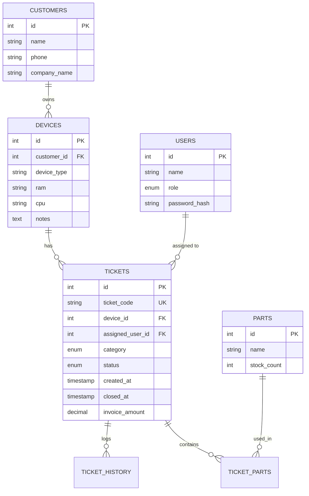

# TS-CRTS — Technical Service & Customer Support Tracking System

<p align="center">
  
  
  
  
  
  
</p>

---

## 📌 Overview

**TS-CRTS (Technical Service & Customer Support Tracking System)** is an enterprise-grade desktop management application designed to streamline technical support workflows, customer device lifecycle tracking, spare parts inventory control, and technical operations reporting. 

Built in **Java 17** using **Swing** with the modern **FlatLaf** UI suite and backed by **MySQL**, the application implements a decoupled Data Access Object (DAO) architecture with robust Role-Based Access Control (RBAC).

---

## 🚀 Key Features

### 🔐 1. Role-Based Access Control (RBAC)
Dedicated user workspaces tailored to operational roles:
* **Manager:** Full administrative oversight, performance KPI summaries, and financial reports.
* **Engineer:** Handles high-level software, ERP installations, database integrations, and e-transformation tickets.
* **Technician:** Focuses on hardware repairs, physical component diagnostics, and device maintenance.
* **IT Staff:** Manages networking, connectivity issues, and infrastructure tickets with real-time peer availability tracking.
* **Customer Support:** Intake desk for registering customers, logging devices/services, and generating repair tickets.

### 🎫 2. Ticket Lifecycle & Workflow Routing
* **Automated Ticket Generation:** Unique alphanumeric ticket tracking codes formatted as `TK-YYYYMMDD-XXXX`.
* **State Progression:** Tickets transition through defined states: `Pending` ➔ `In Progress` ➔ `Completed` ➔ `Archived`.
* **Smart Category Assignment:** Engineers, technicians, and IT staff can self-assign tickets aligned with their specializations.
* **Interactive Work History:** Full chronological activity log capturing diagnostic notes, technician remarks, and updates per ticket.

### 📦 3. Spare Parts & Inventory Management
* **Real-time Stock Tracking:** Parts catalog with automated inventory decrements when parts are assigned to a ticket.
* **Stock Validation:** Guards against assigning parts exceeding on-hand inventory quantities.
* **Part Audit Trail:** Full traceability of parts used per service ticket.

### 🔍 4. Customer & Device Asset Management
* **Comprehensive Customer Directory:** Quick lookup by customer name, phone number, or company.
* **Device Registry:** Tracks client equipment specifications (CPU, RAM, Device Type, Service notes).
* **Repair History Log:** Historical breakdown of all prior interventions performed on client hardware.

### 📊 5. Manager Analytics & Financial Reporting
* **Monthly Volume Metrics:** Overview of active, pending, resolved, and archived tickets.
* **Category Breakdown:** Statistical distribution of issues (SQL Database, ERP, E-Transformation, Hardware, Network).
* **Resolution Performance:** Calculation of average resolution times in hours.
* **Financial Billing Summary:** Invoice totaling for completed and archived service tickets.

### 🎨 6. Modern FlatLaf Dark Interface
* Clean FlatLaf Dark theme with custom badge tags, rounded input components, card layouts, and responsive tab navigation.

---

## 🏛️ System Architecture

TS-CRTS follows a modular, layered Data Access Object (DAO) design pattern:

```
src/main/java/com/mkbilgisayar/tscrts/
│
├── model/                  # POJO Domain Entities
│   ├── User.java           # System users and roles
│   ├── Customer.java       # Customer records
│   ├── Device.java         # Customer devices & hardware specs
│   ├── Ticket.java         # Service ticket core model
│   ├── TicketHistory.java  # Ticket audit / progress notes
│   ├── Part.java           # Inventory spare parts
│   └── TicketPart.java     # Join model for ticket part allocations
│
├── dao/                    # Data Access Objects (CRUD & SQL Queries)
│   ├── UserDAO.java
│   ├── CustomerDAO.java
│   ├── DeviceDAO.java
│   ├── TicketDAO.java
│   ├── TicketHistoryDAO.java
│   ├── PartDAO.java
│   └── TicketPartDAO.java
│
├── ui/                     # FlatLaf Swing Views & Panels
│   ├── MainApp.java              # Main Application Window & View Router
│   ├── LoginPanel.java           # Secure Authentication View
│   ├── DashboardPanel.java       # Dynamic Role Dashboard Container
│   ├── TicketCreationPanel.java  # Ticket & Customer Registration View
│   ├── TicketListPanel.java      # Searchable & Filterable Ticket Table
│   ├── TicketDetailPanel.java    # Full Ticket Inspection, Notes & Parts
│   ├── CustomerHistoryPanel.java # Customer Device Audit & Historical Logs
│   └── ReportingPanel.java       # Manager KPI & Analytics Dashboard
│
└── util/                   # Utility Classes
    ├── DatabaseUtil.java   # MySQL JDBC Connection Manager
    └── UIUtils.java        # UI Styling, Badges, Colors & Formatters
```

---

## 🗄️ Database Schema

The database model is defined in `src/main/resources/schema.sql`:



---

## ⚡ Getting Started

### 📋 Prerequisites
* **Java Development Kit (JDK):** Version 17 or higher
* **Apache Maven:** Version 3.8 or higher
* **MySQL Server:** Version 8.0 or higher

---

### 🛠️ 1. Clone & Setup Database

1. Clone the repository:
   ```bash
   git clone https://github.com/MirsatAnka/TS-CRTS.git
   cd TS-CRTS
   ```

2. Import the database schema into MySQL:
   ```bash
   mysql -u root -p < src/main/resources/schema.sql
   ```
   *(This creates the `tscrts_db` database, tables, and populates default test users and sample inventory parts).*

---

### ⚙️ 2. Database Configuration

You can configure MySQL connection credentials either by setting environment variables or by modifying `DatabaseUtil.java`:

#### Environment Variables (Recommended):
| Variable | Description | Default Value |
| :--- | :--- | :--- |
| `DB_URL` | JDBC Connection URL | `jdbc:mysql://localhost:3306/tscrts_db?useSSL=false&serverTimezone=UTC&allowPublicKeyRetrieval=true` |
| `DB_USER` | MySQL Username | `root` |
| `DB_PASSWORD` | MySQL Password | *(your password)* |

On Windows (PowerShell):
```powershell
$env:DB_USER="root"
$env:DB_PASSWORD="your_mysql_password"
```

On Linux / macOS:
```bash
export DB_USER="root"
export DB_PASSWORD="your_mysql_password"
```

---

### 💻 3. Build & Run

#### Using Maven:
```bash
# Build the project
mvn clean compile

# Run the application
mvn exec:java -Dexec.mainClass="com.mkbilgisayar.tscrts.ui.MainApp"
```

#### Packaging into an Executable JAR:
```bash
mvn clean package
java -jar target/tscrts-1.0-SNAPSHOT.jar
```

#### Using IntelliJ IDEA:
1. Open the project folder in IntelliJ IDEA.
2. Allow Maven to import dependencies automatically.
3. Navigate to `src/main/java/com/mkbilgisayar/tscrts/ui/MainApp.java`.
4. Right-click and choose **Run 'MainApp.main()'**.

---

## 🔑 Default Test Credentials

The database schema pre-seeds test accounts for each role:

| Name | Role | Default Password | Specialization / Permissions |
| :--- | :--- | :--- | :--- |
| **Admin Manager** | `manager` | `admin` | Full System Access & Analytics Reports |
| **Ali Engineer** | `engineer` | `test1234` | SQL Databases, ERP Installation, E-Transformation |
| **Veli Technician** | `technician` | `test1234` | Hardware Diagnostics & Component Repairs |
| **Hasan IT Support 1** | `it_staff` | `test1234` | Network Infrastructure & System Connectivity |
| **Huseyin IT Support 2** | `it_staff` | `test1234` | Network Infrastructure & System Connectivity |
| **Ayse Customer Support** | `customer_support` | `test1234` | Customer Onboarding & Ticket Creation |

---

## 🧑‍💻 Author

* **Mirsat Anka** — *Senior Computer Engineering Student & Backend Developer*
  * GitHub: [@MirsatAnka](https://github.com/MirsatAnka)

---

## 📄 License

This project is licensed under the [MIT License](LICENSE).
